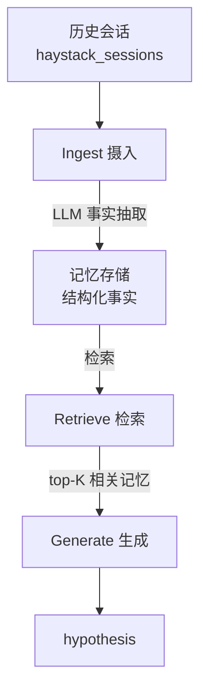

# DIVE-LongMemEval：长期交互式 AI 记忆系统

基于 LongMemEval Oracle 基准的长期记忆系统 Demo：将历史会话抽取为结构化事实，答题时检索相关记忆并由大模型生成答案。

- **课题方向**：Long-term AI Interactive Memory System（长期交互式 AI 记忆系统）
- **数据集**：LongMemEval Oracle（500 题）
- **当前基线**：Overall Accuracy 56%（本地粗评口径）
- **作者**：顾泉

## 系统架构



流水线分为四个模块：**Ingest（写入）→ Store（存储）→ Retrieve（检索）→ Generate（生成）**，记忆模块与底层 LLM 解耦，更换模型无需重写记忆逻辑。

## 目录结构

| 文件 / 目录 | 说明 |
| --- | --- |
| `memory_system.py` | 记忆系统核心：事实抽取、检索、记忆数据结构 |
| `run_demo.py` | 运行入口：读题 → 摄入 → 检索 → 答题 → 输出结果 |
| `data/` | LongMemEval Oracle 数据集 |
| `predictions.jsonl` | 答题结果，每行 `{"question_id": ..., "hypothesis": ...}` |
| `config.example.py` | 配置模板（不含真实 API key，供参考） |
| `个人技术方案.md` | 完整个人技术方案：架构、记忆机制、选型论证、实验结果与后续计划 |

## 快速开始

1. 安装依赖（Python 3.10+），按代码中的 import 安装所需包。
2. 复制配置模板并填入自己的 API key：
   ```
   copy config.example.py config.py
   ```
   在 `config.py` 中填写 `DEEPSEEK_API_KEY`。
3. 运行：
   ```
   python run_demo.py
   ```
4. 结果写入 `predictions.jsonl`，支持断点续跑，中断后重跑自动跳过已答题。

## 当前结果（500 题 Oracle 基线）

| 题型 | 正确率 |
| --- | --- |
| single-session-user | 81% |
| knowledge-update | 78% |
| temporal-reasoning | 68% |
| multi-session | 44% |
| single-session-assistant | 14% |
| single-session-preference | 17% |
| **Overall** | **56%** |

> 注：上表为本地粗评（关键词匹配），正式评分以官方 `evaluate_qa.py` + GPT-4o 裁判为准。

## 选型与设计说明

详细的方案比较与取舍、记忆机制设计、已知局限及后续计划，见 [个人技术方案.md](个人技术方案.md)。

## 后续计划

- 优化记忆抽取 prompt，改善偏好类、AI 发言类题型
- 构建带日期的事实时间线，强化时间推理与知识更新
- 抽取结果持久化缓存，避免重复调用
- 接入官方评测脚本，出正式评分

> （注：部分内容由豆包 AI 生成）