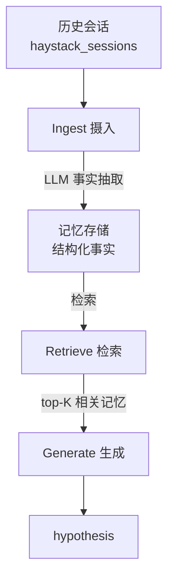

# 个人技术方案：长期交互式 AI 记忆系统

**长期交互式 AI 记忆系统（Long-term AI Interactive Memory System）**

赛诺菲 × 川大 D.I.V.E. 2026 秋季 · 个人技术方案（初稿）
姓名：顾泉

---

## 一、项目背景与目标

大语言模型在长期、跨会话交互中普遍存在遗忘、事实不一致、信息更新识别不足等问题。仅依赖大上下文窗口，无法从根本上解决长期记忆问题，且长上下文下的细节检索能力会显著衰减。

本课题要求：设计并实现一套可复现的记忆系统（Memory System），覆盖信息抽取、组织、更新、检索与复用，并以 LongMemEval Oracle（500 题）为统一基准进行可复现评估。

本阶段目标：

- 搭通「历史会话摄入 → 记忆抽取 → 检索 → 答题」完整流水线
- 在 500 题 Oracle 上跑出 Overall Accuracy 基线
- 按题型分析记忆机制的有效性，识别薄弱环节并迭代

## 二、系统总体架构

系统由四个核心模块构成：Ingest（写入）、Store（存储）、Retrieve（检索）、Generate（生成）。记忆模块与底层 LLM 解耦，更换底层模型时不需要重写记忆逻辑。整体数据流如下：

## 三、记忆机制设计

### 3.1 写入（Ingest）

- **触发时机**：按时间顺序摄入每一段历史会话（session）
- **信息粒度**：不原样存储对话，而是先调用 LLM 将每段对话提炼为若干条“事实”，每条事实附带该会话发生的日期
- **保留信息类型**：用户偏好、参加过的事件（含日期）、购买记录、家庭成员、日程、计划、物品，以及对既有事实的更新
- **降级策略**：若 LLM 抽取失败，退化为原样存储对话轮次，保证流水线不中断

### 3.2 记忆结构与分层

当前实现将记忆统一抽象为“事实条目”：每条记忆包含文本内容、来源会话日期、来源会话编号。

- **情景记忆（Episodic）**：每条事实绑定来源会话与日期，已覆盖
- **语义记忆（Semantic）**：事实抽取过程即做了初步语义压缩
- **工作记忆（Working）**：答题时临时组装 top-K 事实送入上下文

后续计划：显式区分情景记忆与长期语义记忆，对高频事实做向量化沉淀。

### 3.3 更新与冲突

- **时间优先**：答题时提示模型“若同一事实在不同日期出现不同值，取最新一条”
- **抽取阶段即处理更新**：事实抽取 prompt 要求“若同一事实被后续更新，只输出最新版本”
- **历史版本保留**：每条记忆仍保留原始日期，可追溯

### 3.4 遗忘与生命周期

- 当前阶段未实现显式遗忘（单题记忆量约 20 条）
- 后续计划：基于时效、访问频率、容量上限设定淘汰策略

## 四、存储与检索

### 4.1 存储方案

- **当前实现**：内存中的结构化列表，每条事实一条记录，无外部数据库
- **选型理由**：单题记忆量小（约 20 条），内存列表足够；先跑通流水线再优化存储
- **后续计划**：引入向量库（如 FAISS）做语义存储，或关系库存事实

### 4.2 检索策略

- **当前主用**：关键词重合度打分（问题关键词 ∩ 记忆关键词），取 top-K
- **已实验变体 1**：跨会话均衡检索（每会话各取 2 条）——效果不佳，已弃用
- **已实验变体 2**：语义检索（sentence-transformers 向量相似度）——500 题实测与关键词持平，未带来净提升
- **辅助机制**：提示模型在问“隔几天/谁先发生”时，从记忆中提取日期自行做日期推算

## 五、交互与集成

- **入口**：`python run_demo.py`，从 JSON 读题 → 逐题 ingest/检索/答题 → 输出 `predictions.jsonl`
- **输出格式**：每行 `{"question_id": "...", "hypothesis": "..."}`，符合 Oracle 评测要求
- **断点续跑**：每答完一题即存盘，中断后重跑自动跳过已答题
- **记忆与 LLM 解耦**：更换底层模型只需改 config 里的 `MODEL` 字段

## 六、实验结果（500 题 Oracle 基线）

| 题型 | 正确/总数 | 正确率 |
| --- | --- | --- |
| single-session-user | 57/70 | 81% |
| knowledge-update | 61/78 | 78% |
| temporal-reasoning | 91/133 | 68% |
| multi-session | 58/133 | 44% |
| single-session-assistant | 8/56 | 14% |
| single-session-preference | 5/30 | 17% |
| **Overall** | **280/500** | **56%** |

注：上表为本地粗评（关键词匹配），正式评分以官方 `evaluate_qa.py` + GPT-4o 裁判为准。

已做的对比实验：

- 跨会话均衡检索：multi-session 无提升
- 语义检索：与关键词持平（56%→56%）
- TOP_K 10→18：knowledge-update 提升，但 assistant 下降，整体持平

## 七、选型理由与已知局限

### 7.1 选型论证（方案比较与取舍）

本阶段目标是先搭建可复现基线，因此选型优先考虑实现简单、可解释、调用成本可控。动手前先对每一类关键技术列出候选方案，从成本、效果、接入与复现门槛等维度比较，再决定取舍，具体见下表。

| 关键技术 | 候选方案 | 对比维度 | 选择与排除理由 |
| --- | --- | --- | --- |
| 答题大模型 | DeepSeek-chat；GPT-4o；Claude；本地开源模型 | 调用成本、英文问答能力、API 兼容性、部署与复现门槛 | 选 DeepSeek-chat：OpenAI 兼容接口、接入成本低，英文能力满足数据集需求，调用成本可控，适合先跑通基线。排除 GPT-4o / Claude：调用成本较高，基线阶段性价比不足；排除本地开源模型：需自行部署并依赖本地算力，复现门槛高。 |
| 记忆写入方式 | 原样存储对话；LLM 事实抽取；向量摘要 | 记忆噪音、上下文占用、日期等关键细节保留度 | 选 LLM 事实抽取：将对话压缩为结构化事实，降低寒暄噪音。排除原样存储：闲聊噪音大、易干扰答题；排除向量摘要：粒度偏粗，不便保留日期等关键细节。 |
| 检索方式 | 关键词匹配；纯语义向量检索；关键词+语义混合检索 | 实现复杂度、可解释性、额外依赖、召回效果 | 基线阶段选关键词匹配：实现简单、可解释、无额外模型依赖，便于先定位问题。排除纯语义检索：依赖 embedding 模型、流程更重，作为基线后的实验项；排除混合检索：实现复杂度更高，待检索效果分析后再决定。 |
| 存储方案 | 内存列表；向量库（FAISS）；关系数据库 | 数据规模、搭建与维护成本、检索定型程度 | 选内存列表：单题记忆量约 20 条，内存足以承载，先跑通流水线。排除向量库 / 关系库：需额外搭建维护，在记忆量小、检索尚未定型阶段收益有限，留待后续。 |

需要说明：上表为动手前的选型判断；基线搭建完成后，我额外实验了跨会话均衡检索、语义检索、TOP_K 调整等变体（结果见第六节），这些属于事后实验结论，用于检验基线方案，不改变上述选型理由。

### 7.2 已知局限

- **检索瓶颈**：关键词检索对“意思相近但用词不同”的 query 召回弱；语义检索本数据集未带来净提升，需进一步分析原因
- **薄弱题型**：single-session-preference（17%）、single-session-assistant（14%）——答案常藏在单条细节记忆里，当前抽取可能丢失了偏好与 AI 发言
- **无显式遗忘与冲突消解**：仅靠 prompt 提示“取最新”，未做结构化时间线
- **存储未持久化**：每次跑题都重新抽取，未缓存记忆，效率有优化空间

## 八、后续计划（11 月）

- 优化记忆抽取 prompt：让偏好类、AI 发言类事实不被丢失（主攻 17%/14% 两类）
- 时间线结构化：对 temporal / knowledge-update 题构建带日期的事实序列
- 记忆缓存：抽取结果持久化，避免重复调用
- 接官方评测脚本：用 GPT-4o 裁判出正式分数，替换本地粗评
- 完成架构文档与评估报告，准备 12 月答辩
